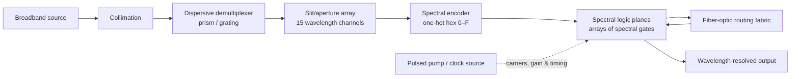
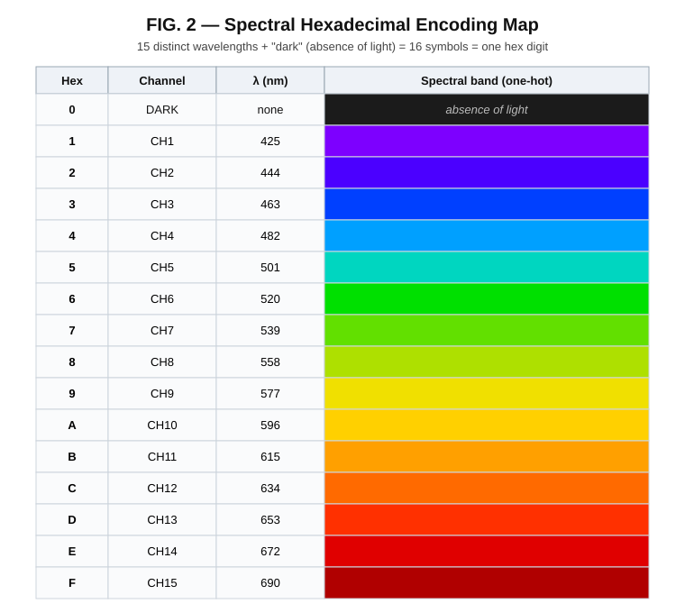
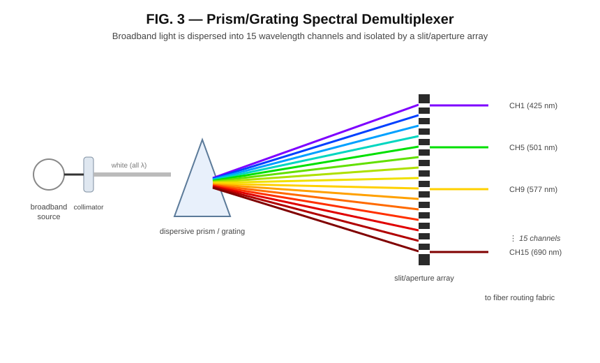
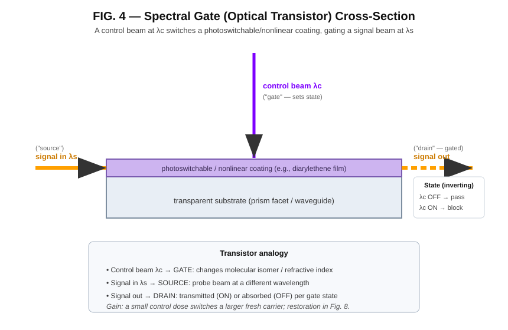
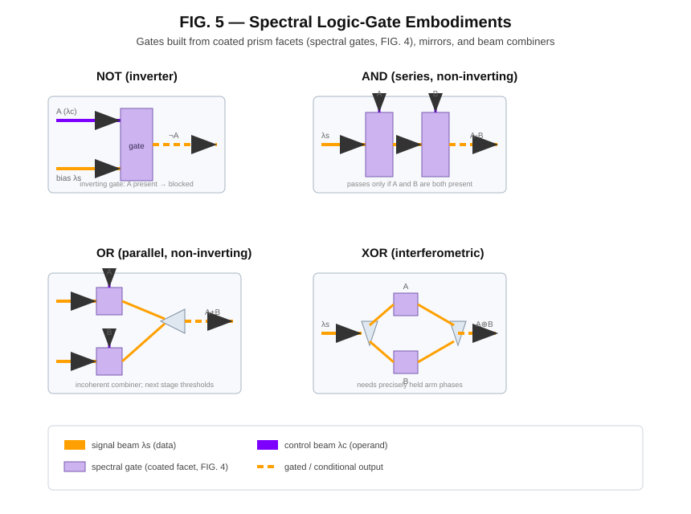
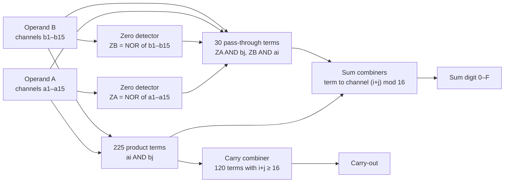
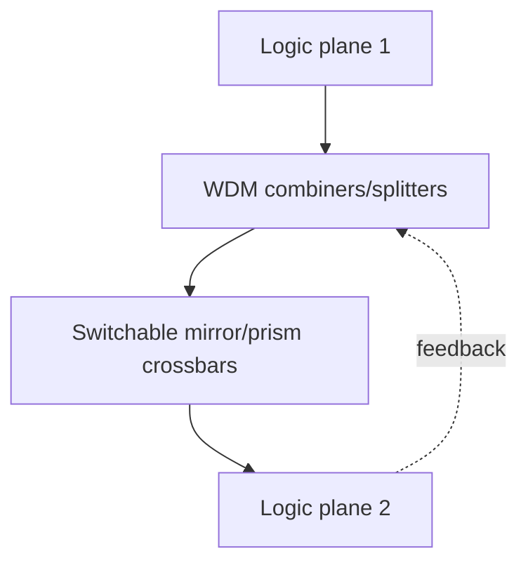
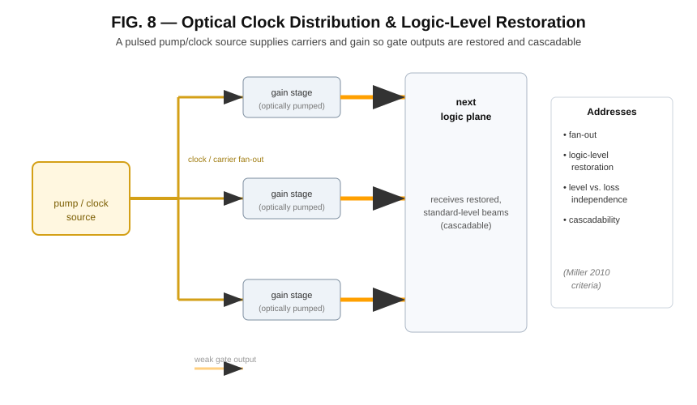
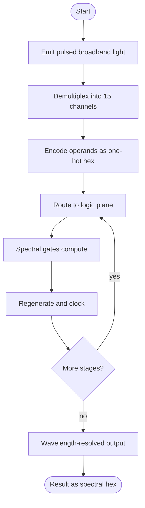

# An All-Photonic Spectral-Hexadecimal Computing Architecture

**Working paper**

**Author:** Adam Androulidakis 
**Email:** serpentchain@gmail.com 
**Date:** 1 June 2022 
**Revised:** 27 October 2026 

---

## Abstract

We examine the feasibility of an all-photonic computing architecture that performs
hexadecimal logic directly in the optical-wavelength domain, with no electronic devices in the
signal path and no optical–electronic–optical (OEO) conversion. Information is carried in a
**one-hot spectral code**: a broadband source is dispersed into fifteen wavelength channels
between approximately 425 and 690 nm, and a base-sixteen digit is represented by light in
exactly one channel (symbols 1–F) or in none ("dark", symbol 0). We assess the architecture
component by component — source and encoding, dispersive routing, the gating element, logic and
arithmetic primitives, and system behavior — against Miller's six criteria for practical optical
logic [1]. Spectral encoding and passive routing with prisms, gratings, mirrors, and fiber rest
on established optics. The gating element determines whether the system can compute: a passive,
linear coating cannot let one beam control another, so the gate must use an **active** material
in which a control beam at one wavelength changes the transmission or phase seen by a signal beam
at another. Photochromic switches (e.g., diarylethenes), saturable absorbers (e.g., graphene),
Kerr-nonlinear media, and phase-change films provide this control; signal gain is obtained by
switching a fresh optical carrier, supplemented where necessary by optically pumped
amplification. With such a gate, Boolean logic and a one-hot hexadecimal adder can be
constructed explicitly; the adder requires 255 two-input product terms, more than an order of
magnitude more gate elements than a 4-bit binary adder. Order-of-magnitude estimates place the
switching energy of a hexadecimal addition three to six orders of magnitude above that of CMOS
for most coating classes. We conclude that the architecture violates no known physics but is
unproven in practice: its viability depends on the energy, gain, and crosstalk budget of a deep
cascade, and on gate materials that are both fast and low-loss across the visible band.

**Keywords:** optical computing, photonic logic, wavelength encoding, all-optical
transistor, photochromism, nonlinear optics, phase-change materials, non-von-Neumann,
dataflow architecture.

---

## 1. Introduction

Electronic digital computers face rising costs in interconnect energy and memory bandwidth —
the "von Neumann bottleneck" — and pay a conversion penalty wherever they meet optical
communication links. Optical computing aims to compute in the optical domain itself, exploiting
the bandwidth, parallelism, and low propagation loss of light.

This paper examines a direct form of that idea: encoding information in wavelength. A
hexadecimal digit is represented as one of fifteen wavelengths or as the absence of light; the
wavelengths are produced by dispersing a broadband source; and computation is performed by
gating individual wavelengths with coated optical elements. The appeal is that the data carrier
(wavelength) is the quantity that dispersive optics manipulate most naturally, and that the
machine need never leave the optical domain.

We assess the architecture stage by stage, asking for each stage whether it rests on
established physics, what prior work has demonstrated, and which real materials could implement
it. The central result is that every stage, from the broadband source to hexadecimal addition,
is physically realizable provided the gate is active — that is, provided a control beam at one
wavelength changes the response seen by a signal beam at another. Several material classes
provide this behavior. What remains open is a system-level question: whether the energy, gain,
and crosstalk budget survives a deep cascade at a cost competitive with electronics.

### 1.1 Contributions

- A **component-by-component feasibility analysis** that separates the stages resting on
  settled physics (dispersion, spectral encoding, optical routing) from the one stage that
  requires an active element (the gate).
- A **one-hot spectral-hexadecimal encoding** (15 wavelengths + dark = 16 symbols) and the
  rationale for its radix.
- A **spectral-gate** element, a survey of **coating materials** that provide control of light
  by light, and an assessment of the gate against Miller's six criteria.
- A **non-von-Neumann dataflow architecture**, including Boolean gates, an explicit one-hot
  hexadecimal adder with its gate count, optical clocking and restoration, and co-located
  optical memory.
- **Order-of-magnitude energy and latency estimates**, a comparison with CMOS, and the
  experiments required to replace the estimates with measurements.

### 1.2 Scope

This is a concept and feasibility study; it reports no laboratory data. "All-photonic" means
that no electronic device lies in the signal path: operands are generated, gated, routed,
stored, and delivered as light. The broadband source and pump lasers are powered externally, as
an electronic processor is powered by its supply rail, and conversion of the final result to
electronic or human-readable form lies outside the computing path. The quantitative figures in
Section 8 are order-of-magnitude estimates assembled from literature values for individual
materials and have not been validated by simulation or experiment for this architecture.
Citations are representative rather than exhaustive.

---

## 2. Background and Related Work

### 2.1 Optical and photonic computing

Optical computing is a mature research field. Current photonic accelerators from industrial and
academic groups perform linear algebra optically while retaining electronic control; they are
hybrid systems and incur OEO conversion. Fully optical, general-purpose machines remain elusive,
largely because optical logic has lacked an element with transistor-like gain and
cascadability [1].

### 2.2 Wavelength-based computing

The closest prior work is **wavelength-based computing** [2, 3]. Goliaei and Jalili let each
wavelength in a light beam represent one candidate assignment of the variables of a 3-SAT
instance, and use prisms and mirrors to select the wavelengths that satisfy the formula. This
shows that prism-and-mirror optics can encode and separate problem variables by wavelength. The
device is, however, **passive and problem-specific**: it evaluates a fixed formula by
construction rather than executing programmable logic, and it does not cascade into computation
of arbitrary depth.

### 2.3 Optical transistors and logic gates

Jain and Pratt patented an optical transistor in which a control beam perturbs a pumped optical
medium to modulate an internal optical signal, together with logic circuits built from such
devices [4]. Later demonstrations include an all-optical transistor gated by a single stored
photon in an atomic ensemble [5], an exciton-polariton transistor [6], and a photonic NOR gate
built from two microring resonators [7]. These results establish that **one light beam
controlling another is experimentally real**.

### 2.4 Criteria for a practical optical logic element

Miller identifies six properties that a practical optical logic device must have [1]:
**cascadability** (the output of one stage can drive the input of the next, with compatible
wavelength, beam shape, and pulse shape); **fan-out** (an output can drive at least two
subsequent inputs); **logic-level restoration** (signal degradation is corrected at each stage
rather than propagated); **input/output isolation** (light reflected back into an output is not
mistaken for an input); **absence of critical biasing** (the operating point need not be set
with high precision); and **logic level independent of loss** (the logic level does not depend on
path loss). Miller also stresses that energy comparisons with electronics must count the total
energy of a logic operation, which in CMOS is at the femtojoule level [1]. We adopt the six
properties as design criteria for the spectral gate (Section 5.4).

### 2.5 Wavelength-division multiplexing and phase-change photonics

Wavelength-division multiplexing (WDM) routinely carries many wavelengths in a single fiber and
is directly relevant to the routing fabric described here. Photonic in-memory computing with
chalcogenide phase-change materials demonstrates optically switched, non-volatile states usable
for both computation and storage [8].

### 2.6 Open gap

The individual ideas exist, but their combination — a broadband source, a 15-channel one-hot
spectral-hexadecimal encoding, prism "spectral gates" carrying photoswitchable or nonlinear
coatings, passive free-space-and-fiber routing, and a non-von-Neumann dataflow with optical
clocking and gain-based restoration — has not, to our knowledge, been described as a single
system. That combination is the subject of this paper.

---

## 3. Physical-Feasibility Analysis

### 3.1 Stages grounded in established optics

| Stage | Assessment | Physical basis |
| --- | --- | --- |
| Broadband source → 15 discrete bands | Sound | Chromatic dispersion (prism) or diffraction (grating) separates wavelengths angularly; a slit array or arrayed-waveguide grating isolates the bands. A ~19 nm channel spacing is well within the resolution of ordinary gratings. |
| 15 wavelengths + dark as one hex digit | Sound | Fifteen lit symbols and one dark symbol give 16 = one hexadecimal digit: a one-hot code extended with an all-dark zero. |
| Routing with mirrors, prisms, gratings, and fiber | Sound | Geometric optics and waveguiding; WDM already multiplexes many wavelengths per fiber. |
| Static masking with coatings | Sound, with a caveat | Absorptive dyes and pigments attenuate light according to the Beer–Lambert law, but their absorption bands are typically several tens of nanometers wide or more. Filters that select individual channels at ~19 nm spacing require thin-film interference coatings or gratings. |

### 3.2 Why a passive gate is insufficient

A gate that behaves like a transistor must let one signal control another and must provide
gain. A passive, linear coating does neither: its transmission is fixed, its output is
proportional to its input, and in a linear medium a second beam passes through without affecting
the first. A network of prisms and fixed filters can therefore implement only **fixed masking**,
a static mapping from input wavelengths to output paths, and it fails the fan-out,
logic-level-restoration, and cascadability criteria. Such networks can solve specific problems
by construction, as in wavelength-based 3-SAT [2, 3], but they are not programmable computers.

### 3.3 Requirements for an active gate

The gate must satisfy three conditions:

1. **Control of light by light.** A control beam at λc changes the absorption, refractive index,
   or phase that a signal beam at λs experiences.
2. **Gain.** A small change in control power must produce a larger change in output power.
   Stimulated-emission gain is not required [1]; it is sufficient for the control to switch a
   larger optical power. Here that power is a fresh carrier drawn from the source, the optical
   counterpart of a supply rail (Section 5.2).
3. **The remaining criteria of Section 2.4**, assessed in Section 5.4.

Sections 5 and 7 describe how the spectral gate and the restoration stages meet these
conditions.

---

## 4. System Architecture

### 4.1 Overview

The machine is organized as an optical **dataflow** rather than a stored-program von Neumann
pipeline. Operands travel as light through a spatial network of logic planes, and each result
propagates directly to the stages that consume it, with optional feedback through the routing
fabric. There is no shared bus and no program counter; memory, where needed, is optical and
placed beside the logic that uses it. The program is the wiring of the dataflow graph: with
fixed mirrors and prisms the machine is a fixed-function processor, and reprogramming requires
switchable routing elements (Section 6.4).

*Figure 1. System architecture (dataflow organization).*

### 4.2 Spectral hexadecimal encoding

A hexadecimal digit is a **one-hot spectral code** over sixteen symbols: channels CH1–CH15
encode symbols 1–F, and the absence of light ("dark") encodes 0. In the reference design the
channel centers are approximately 425, 444, 463, 482, 501, 520, 539, 558, 577, 596, 615, 634,
653, 672, and 690 nm, a spacing of about 19 nm. Channel isolation is set by the demultiplexer
and the channel filters, not by the gate coatings: after demultiplexing, each channel travels on
its own spatial path, so a gate acts only on the channel routed through it. The spectral width
of a coating matters only where a control and a signal wavelength share one gate, and those two
wavelengths must then fall in different response regions of the coating.

*Figure 2. One-hot spectral hexadecimal encoding (15 wavelengths + dark → 0–F).*

One-hot encoding has three advantages: each symbol is a single wavelength that can be filtered,
routed, and gated independently; detecting a symbol reduces to thresholding the presence or
absence of light; and several digits can share a fiber by WDM. Multi-digit words use spatial
parallelism (one path per digit) or time multiplexing under the optical clock. It also has two
costs. First, it is channel-hungry: fifteen wavelengths carry four bits, where a binary
wavelength code would need four. Second, the dark symbol cannot be distinguished from a lost
signal; giving zero its own channel would make every symbol positively signaled, and so allow
loss to be detected, at the cost of a sixteenth wavelength.

The radix is chosen for compatibility with existing data representation. One hexadecimal digit
corresponds to exactly four bits, and bytes, addresses, and machine words are conventionally
written in hexadecimal. A machine that computes natively in base sixteen can therefore exchange
data with binary storage and software through a fixed four-bits-per-digit mapping, with no radix
conversion between the storage layer, the applications that use the data, and the optical
compute layer.

### 4.3 Source and demultiplexer

A broadband source is collimated and dispersed by a prism or grating, and a slit or aperture
array isolates the fifteen channels (Figure 3). A pulsed supercontinuum source is the most
practical choice: it is spatially coherent, so it couples efficiently into single-mode fiber and
waveguides, and its high spectral power density leaves useful power in each ~19 nm channel.
Spatially incoherent sources, such as phosphor-converted LEDs and incandescent emitters, are
simpler but deliver far less power per channel into a single-mode path. A pulsed source can also
provide the system clock (Section 7.1).

*Figure 3. Prism/grating spectral demultiplexer with slit array.*

---

## 5. The Spectral Gate (Optical Transistor)

### 5.1 Principle

A spectral gate consists of a transparent substrate — a prism facet or a waveguide — carrying an
active coating (Figure 4). A **control beam (λc)** illuminates the coating, and a **signal beam
(λs)** passes through or along it. The control beam changes the coating's absorption, refractive
index, or phase at λs, switching the signal between a transmitted (ON) state and a blocked or
phase-shifted (OFF) state. In transistor terms, the control beam is the gate, the incoming
signal is the source, and the outgoing signal is the drain.

Gates come in two polarities. In an **inverting** gate the control beam increases absorption at
λs and blocks the signal, as in photochromic coloring. In a **non-inverting** gate the control
beam reduces absorption and opens the signal path, as in photochromic bleaching or the
saturation of an absorber by an intense control beam. Figure 4 shows an inverting gate. A
complete logic family requires both polarities (Section 6.1).

*Figure 4. Spectral gate: a control beam switches a coating that gates a signal beam (inverting
polarity shown).*

### 5.2 Gain and readout

A gate provides gain when a small control energy switches a larger optical power. In the
spectral gate the switched power is a fresh carrier drawn from the source, so the output level is
set by the carrier rather than by the operand that controls it. Bistable coatings
(diarylethenes, phase-change films) can show large switching gain, because a single control dose
sets a state that then transmits signal for many clock periods. That advantage holds only if
reading the state does not disturb it. In a diarylethene film the visible absorption band that
modulates the signal is the same band that drives ring-opening [9], so the signal must be weak
enough not to switch the film during readout, or the state must be read through its
refractive-index change outside the absorption band, which requires an interferometric or
resonant readout. Where switching gain is insufficient, optically pumped amplification restores
levels between stages (Section 7.2).

### 5.3 Candidate materials

| Class | Mechanism | Representative materials | Notes |
| --- | --- | --- | --- |
| Photochromic switches | Control light isomerizes molecules, shifting the absorption spectrum | Diarylethenes [9] and fulgides (thermally stable, P-type); spiropyrans, azobenzenes, and DASAs (thermally reverting, T-type); Ru-sulfoxide complexes | Molecular isomerization takes picoseconds, but switching a film is limited by the absorbed photon dose. P-type switches need a second wavelength to reset. Diarylethenes are notably fatigue-resistant. |
| Saturable absorbers | An intense control beam bleaches the absorber (non-inverting) | Graphene, carbon nanotubes, quantum dots, organic dyes | Graphene absorbs from the ultraviolet to the terahertz and recovers in sub-picoseconds to picoseconds; a single layer gives a small modulation depth, so waveguide integration is needed. |
| Kerr (χ³) media | Cross-phase modulation; four-wave mixing [10] | Silicon nitride waveguides; silica fiber | Femtosecond response but weak; requires resonators or long interaction lengths, which introduce critical biasing. Silicon is opaque below ~1.1 µm and unsuitable for the visible band. |
| χ² crystals | Sum- and difference-frequency generation [10] | BBO, KTP, LiNbO₃ | Used mainly for wavelength conversion (Section 6.3); requires phase matching. |
| Phase-change materials | Optically switched amorphous ↔ crystalline transition | Ge₂Sb₂Te₅ (GST) [8]; Sb₂S₃ | Non-volatile, so it doubles as memory. GST absorbs strongly across the visible; the wider-gap Sb₂S₃ reduces loss only toward the red end of the band. |

Because data channels lie in the visible, the operand that drives a gate must fall within the
coating's photoactive band. For typical diarylethenes, visible light drives ring-opening
(bleaching) and ultraviolet light drives ring-closing (coloring) [9]; visible operands therefore
produce non-inverting gates directly, and inverting operation requires an ultraviolet control
derived by wavelength conversion. A passive, linear coating has no gain and is not cascadable;
it serves only for fixed masking in static routing or read-only masks.

### 5.4 Assessment against Miller's criteria

| Criterion [1] | How the spectral gate addresses it | Residual risk |
| --- | --- | --- |
| Cascadability | Outputs are produced on fresh carriers at standard channel wavelengths; wavelength conversion is used where a downstream coating needs a different control wavelength. | Beam- and pulse-shape compatibility across many stages is unverified. |
| Fan-out | The control switches a carrier of greater power than itself; the hexadecimal adder requires a fan-out of about 17 (Section 6.2). | Achievable switching gain for each material is unmeasured. |
| Logic-level restoration | Regeneration on fresh carriers, with saturable-absorber thresholding and optically pumped amplification where needed. | Finite switching contrast limits restoration. |
| Input/output isolation | Control and signal use different wavelengths and separate beam paths. | Back-reflections at the signal wavelength still require care. |
| Absence of critical biasing | Absorptive gates (photochromic, phase-change, saturable-absorber) are not interferometric. | Kerr and interferometric XOR gates need precisely held phases [1]. |
| Logic level independent of loss | Each stage regenerates its output on a fresh carrier, resetting the level. | Loss between stages must stay within each gate's switching margin. |

---

## 6. Logic and Hexadecimal Arithmetic

### 6.1 Logic gates

Spectral gates combine with mirrors and beam combiners into Boolean primitives (Figure 5):

- **NOT:** a carrier at λs passes through an inverting gate controlled by A; light emerges only
  when A is absent.
- **AND:** two non-inverting gates in series on one carrier, controlled by A and B; the carrier
  passes only when both are present.
- **OR:** two non-inverting gates on parallel carrier paths, merged in a combiner. When both
  paths are open the combined power doubles, so the paths are combined incoherently (with a path
  difference beyond the coherence length) and the following stage thresholds the level.
- **NOR and NAND:** inverting gates in series and in parallel, respectively. NOR alone is
  functionally complete, and an all-optical microring NOR gate has been demonstrated [7].
- **XOR:** either an interferometer with a phase-shifting gate in each arm, whose arms cancel
  when both or neither input is present, or the composition (A ∨ B) ∧ ¬(A ∧ B). The
  interferometric form is compact but requires precisely held arm phases — the critical biasing
  that Miller cautions against [1] — so the composed form is preferred with absorptive gates.

*Figure 5. NOT, AND, OR, and XOR built from spectral gates, mirrors, and combiners.*

### 6.2 Hexadecimal addition

Addition operates directly on the one-hot code. Let a1…a15 and
b1…b15 denote the channels of operands A and B, with an all-dark operand
representing zero. For nonzero operands, each pair (i, j) forms a **product term**
ai ∧ bj: an AND gate whose carrier is at the wavelength of sum channel
s(i+j) mod 16. The 15 terms with i + j = 16 give a sum of zero and drive no sum
channel. The carry output is the OR of the 120 terms with i + j ≥ 16, tapped from those terms
and regenerated onto a dedicated carry carrier. When one operand is zero, the sum equals the
other operand: a zero detector ZA = NOR(a1, …, a15), built as
fifteen inverting gates in series on one carrier, enables fifteen pass-through terms
ZA ∧ bj → sj, and ZB enables the symmetric terms. The
adder therefore uses 225 + 30 = 255 two-input product terms and two fifteen-gate zero
detectors — about 540 gate elements — plus the carry combiner.

*Figure 6. One-hot hexadecimal half-adder built from product terms.*

Two properties follow. Because each operand is one-hot, at most one product term is active in
any clock slot, so the combiners never sum two signals and no level arithmetic is needed. And
because each term's carrier is already at its output wavelength, the adder needs no wavelength
conversion. The cost is size. A 4-bit binary ripple-carry adder needs about twenty two-input
gates, so the one-hot adder uses more than an order of magnitude more gate elements, and each
operand channel must fan out to about seventeen gates: fifteen product terms, one pass-through
term, and one zero detector.

A full adder adds a carry-in c. In the one-hot code, adding c is a conditional cyclic shift of
the sum by one channel, with a zero detector on the sum to handle the dark state. Carry-out is
additionally asserted when A + B = 15 and c = 1. Chaining full adders gives multi-digit addition
and the basis of a hexadecimal arithmetic-logic unit.

### 6.3 Wavelength conversion

Where a signal must change wavelength — for example, to drive a coating whose photoactive band
differs from the channel wavelength — an all-optical converter based on four-wave mixing or
difference-frequency generation [10] translates the carrier while preserving the logical state.
Both processes require phase matching and high peak intensity, which favors pulsed operation.

### 6.4 Interconnect and programmability

A fiber routing fabric carries several digits per fiber by WDM, and mirror and prism crossbars
define the spatial wiring of the dataflow graph (Figure 7). With fixed optics the wiring, and
therefore the program, is fixed. A reconfigurable machine replaces fixed crossbar elements with
optically switchable ones, such as phase-change switches; the routing state then acts as the
stored program.

*Figure 7. Fiber-optic interconnect and routing fabric.*

---

## 7. Clocking, Restoration, and Memory

### 7.1 Optical clock

A pulsed source defines the clock: each pulse is a time slot in which the gates are evaluated.
A mode-locked laser driving supercontinuum generation can supply both the clock and the fresh
carriers of Section 5.2, so that timing and optical power share one distribution tree
(Figure 8).

### 7.2 Restoration and amplification

Where switching gain falls short, amplifiers restore output levels and supply fan-out. To keep
electronics out of the signal path, the gain media must be optically pumped: dye-doped polymer
waveguides, rare-earth-doped glass or fiber, or optically pumped semiconductor films.
Semiconductor optical amplifiers, the most common integrated amplifiers, are electrically pumped,
and using them would make the machine hybrid. No single gain medium covers 425–690 nm, so a
design that relies on amplification needs several media, each serving part of the band.
Regeneration on fresh carriers (Section 5.2) reduces this dependence and is the preferred
restoration mechanism.

*Figure 8. Optical clock distribution and logic-level restoration.*

### 7.3 Memory

Optical memory sits beside the logic it serves. Phase-change cells hold non-volatile, optically
set states [8], although GST must be read at wavelengths where its loss is acceptable
(Section 5.3). Alternatives are bistable resonators and regenerative loops that latch circulating
light; these are volatile and draw power continuously. Placing memory beside logic removes the
processor–memory bus.

### 7.4 Process summary

*Figure 9. Computation process flow.*

---

## 8. Discussion and Limitations

### 8.1 Engineering challenges

The architecture breaks no physical law, but the following challenges must be quantified before
any performance claim can be made.

1. **Switching speed.** Molecular photoisomerization takes picoseconds, but switching a film to
   useful contrast is limited by the absorbed photon dose and takes microseconds to milliseconds
   at practical intensities; P-type switches must also be reset at a second wavelength.
   Ru-sulfoxide complexes switch in tens of picoseconds to nanoseconds, GST in nanoseconds to
   about a hundred nanoseconds, and Kerr nonlinearities respond in femtoseconds but are weak. The
   coating sets the clock rate, and speed, energy, and robustness trade against one another
   across material classes.
2. **Energy and gain budget.** Each gate consumes control energy, and regeneration consumes
   carrier and pump energy. Whether net gain can be sustained through a deep cascade, and at what
   energy per operation, is the central open question.
3. **Carrier power.** In the product-term adder, every term's carrier must be present in every
   slot, and the carriers of the inactive terms are absorbed or discarded. Carrier power, rather
   than switching energy, may dominate the budget (Section 8.2).
4. **Gate count.** One-hot arithmetic grows with the square of the radix: the hexadecimal adder
   needs about 540 gate elements, against about 20 gates for a 4-bit binary adder.
5. **Spectral crosstalk and channel count.** Fifteen channels at ~19 nm spacing require filters
   with steep edges and low thermal drift, and the dark symbol cannot be distinguished from
   signal loss (Section 4.2).
6. **Cascade depth and noise.** Amplified spontaneous emission, finite switching contrast, and
   alignment tolerances accumulate; the usable logic depth between regeneration stages is
   unknown without experiment.
7. **Visible-band materials.** Several of the best-developed active platforms perform poorly at
   425–690 nm: silicon is opaque, GST absorbs strongly, and common chalcogenide glasses absorb
   toward the blue. A gate material that is fast, efficient, and low-loss across the whole band
   has not been identified.
8. **Fatigue and reversibility.** Photochromic films degrade over switching cycles, diarylethenes
   less than most, and phase-change endurance is finite. Device lifetime is limited by the
   material.
9. **Footprint and integration.** Free-space prism and mirror assemblies are bulky and
   alignment-sensitive. An integrated design — an arrayed-waveguide-grating demultiplexer and
   microring spectral gates with switchable cladding on a visible-transparent platform such as
   silicon nitride — is likely necessary at scale.

A programmable all-photonic spectral-hexadecimal computer therefore requires active gate
materials, and its competitiveness with electronics is unproven.

### 8.2 Order-of-magnitude estimates

The figures below combine literature values for individual material classes with generic device
physics under simplifying assumptions. They have not been validated by simulation or experiment
for this architecture and may be wrong by orders of magnitude. They indicate which parameters
matter and roughly where those parameters lie; they are not results, and the ranges are
deliberately wide.

**Per-gate switching time and energy.** Values in a packaged spectral gate depend on mode
confinement, coating thickness, contrast target, and wavelength.

| Coating class | Est. switching time | Est. switching energy per operation | Volatility | Confidence |
| --- | --- | --- | --- | --- |
| Diarylethene (photochromic) | ~ps (molecular); ~1 µs – 1 ms (film, dose-limited) | ~pJ – nJ | Non-volatile; reset at a second wavelength | Low |
| Ru-sulfoxide (fast photoswitch) | ~50 ps – 1 ns | ~pJ – nJ | Metastable | Very low |
| Saturable absorber (graphene) | ~0.1 – 1 ps recovery | ~fJ – pJ (threshold-set) | Volatile | Low |
| Kerr / χ³ (resonator-enhanced) | ~fs – ps | ~pJ – nJ | Volatile | Very low |
| GST phase-change | ~1 – 100 ns | ~10 pJ – 1 nJ | Non-volatile | Low–medium |

**System-level estimates for the hexadecimal half-adder.** These follow from the construction in
Section 6.2 and the per-gate values above. They ignore layout and the distribution of coupling
loss.

| Quantity | Estimate | Basis and caveats |
| --- | --- | --- |
| Symbols per channel group | 15 + dark = 16 | Set by design. |
| Channel spacing | ~19 nm over 425–690 nm | Design value; usable spacing depends on filter roll-off and crosstalk, which are untested. |
| Gate elements | ~540 | 255 two-input product terms plus two 15-gate zero detectors; excludes the carry combiner. |
| Gate-switching events per addition | ~30–35 | Each lit operand channel drives ~17 gates. |
| Single-digit add latency | ~ps – ns (Kerr, saturable absorber, Ru); ~1 – 100 ns (GST); ~µs – ms (photochromic films) | Two to three gate stages; dominated by the slowest coating in the path. |
| Switching energy per addition | ~30 pJ – 30 nJ (photochromic, Kerr, GST); ~30 fJ – 30 pJ (graphene) | ~34 events × per-gate energy; excludes carrier and pump energy. |
| Carrier energy per clock slot | Up to ~10² × the switching energy | 255 carriers, each sized to drive ~17 downstream gates, of which at most one is used. |
| Cascade depth before regeneration | A few to ~10 stages | Assumption; noise and contrast accumulation are unmeasured. |
| Insertion loss per gate | ~1 – 6 dB | Typical range for coated elements; not modeled. |
| Channel crosstalk | < −20 dB required | Required, not demonstrated. |

**Comparison with CMOS.** Horowitz reports 0.03 pJ for an 8-bit integer addition and 0.1 pJ for
a 32-bit addition in 45 nm CMOS at 0.9 V [11], so a single 4-bit (one hexadecimal digit)
addition costs on the order of 0.01–0.03 pJ in that node. Miller places the total energy per
logic operation in CMOS at the femtojoule level and notes that comparisons must count total
energy, not signal energy alone [1]. Against these figures, the switching energy of a
spectral-hexadecimal addition is three to six orders of magnitude higher for photochromic, Kerr,
and phase-change gates, before carrier and pump energy are included. Only saturable-absorber
gates near the bottom of their threshold range approach parity, and they have not been
demonstrated in this configuration. On latency, only femtosecond-to-picosecond gates (Kerr,
saturable absorption) could match sub-nanosecond CMOS adders; phase-change and photochromic gates
cannot.

**Sources of uncertainty.** (i) Per-material figures come from disparate experiments (different
wavelengths, geometries, and contrast definitions) and may not transfer to a spectral gate.
(ii) The regeneration budget that makes cascading possible consumes energy and has not been
modeled. (iii) Carrier power is bounded, not modeled. (iv) Crosstalk, alignment, and thermal
drift are omitted. (v) No end-to-end simulation has been run.

---

## 9. Future Work

- **Single-gate demonstration:** measure switching contrast, speed, energy, switching gain, and
  isolation for a diarylethene gate and a saturable-absorber gate at chosen λc/λs, and for a
  phase-change gate at red or near-infrared wavelengths.
- **Readout study:** quantify the trade-off between readout contrast and readout disturbance in
  photochromic gates, including refractive-index readout outside the absorption band.
- **Cascade experiment:** build a two- to three-gate cascade with regeneration on fresh carriers
  to test cascadability and noise accumulation.
- **System simulation:** model the hexadecimal half-adder end to end — channel crosstalk, carrier
  power, gain budget, and timing — to estimate energy per operation and maximum logic depth, and
  replace the estimates of Section 8.2 with validated figures.
- **Integrated design:** design an arrayed-waveguide-grating demultiplexer with microring spectral
  gates and switchable cladding on silicon nitride, removing free-space alignment.
- **Encoding study:** compare one-hot spectral hexadecimal with binary wavelength codes (four
  channels per digit) and with amplitude and phase encodings, in gate count, energy, and error
  tolerance.

---

## 10. Conclusion

Taken stage by stage, the all-photonic spectral-hexadecimal architecture is physically
realizable. Dispersing a broadband source into fifteen channels, representing a hexadecimal digit
as one lit channel or none, and routing the channels with prisms, gratings, mirrors, and fiber
all rest on established optics. The gate is the one stage that must let one beam control another
and provide gain. A passive coating cannot do this, but photochromic, saturable-absorbing,
Kerr-nonlinear, and phase-change coatings can, with gain obtained by switching fresh carriers and,
where needed, by optically pumped amplification. On such gates, Boolean logic and a one-hot
hexadecimal adder can be built explicitly.

The same analysis exposes the costs. One-hot arithmetic needs far more gates than binary
arithmetic; every candidate gate material trades speed against energy and loss; the
best-developed silicon and phase-change platforms are poorly suited to the visible band; and
order-of-magnitude estimates put the energy of an addition well above that of CMOS for most
coating classes. The architecture therefore violates no known physics, but its practicality is
unproven. Feasibility is decided by whether the energy, gain, crosstalk, and timing budget
survives a deep cascade, not by the choice of any single component, and that question can be
settled by the experiments and simulations of Section 9.

---

## References

1. D. A. B. Miller, "Are optical transistors the logical next step?", *Nature Photonics* 4,
   3–5 (2010).
2. S. Goliaei and S. Jalili, "An optical wavelength-based solution to the 3-SAT problem," in
   *Optical SuperComputing (OSC 2009)*, Lecture Notes in Computer Science 5882, pp. 77–85
   (Springer, 2009).
3. S. Goliaei and S. Jalili, "An optical solution to the 3-SAT problem using wavelength based
   selectors," *Journal of Supercomputing* 62, 663–672 (2012).
4. K. Jain and G. W. Pratt, Jr., "Optical transistors and logic circuits embodying the same,"
   U.S. Patent 4,382,660 (filed 16 June 1976; issued 10 May 1983; assignee: Massachusetts
   Institute of Technology).
5. W. Chen et al., "All-optical switch and transistor gated by one stored photon," *Science*
   341, 768–770 (2013).
6. D. Ballarini et al., "All-optical polariton transistor," *Nature Communications* 4, 1778
   (2013).
7. T. A. Ibrahim, K. Amarnath, L. C. Kuo, R. Grover, V. Van, and P.-T. Ho, "Photonic logic NOR
   gate based on two symmetric microring resonators," *Optics Letters* 29, 2779–2781 (2004).
8. C. Ríos, N. Youngblood, Z. Cheng, M. Le Gallo, W. H. P. Pernice, C. D. Wright, A. Sebastian,
   and H. Bhaskaran, "In-memory computing on a photonic platform," *Science Advances* 5,
   eaau5759 (2019).
9. M. Irie, "Diarylethenes for memories and switches," *Chemical Reviews* 100, 1685–1716 (2000).
10. R. W. Boyd, *Nonlinear Optics*, 4th ed. (Academic Press, 2020).
11. M. Horowitz, "Computing's energy problem (and what we can do about it)," in *IEEE
    International Solid-State Circuits Conference (ISSCC) Digest of Technical Papers*,
    pp. 10–14 (2014).
